<!-- @nnthach · palette: sky #0EA5E9 · emerald #10B981 · ink #0F172A · surface #F0F9FF -->

<picture>
  <source media="(max-width: 640px)" srcset="assets/header-mobile.svg" />
  
</picture>

 

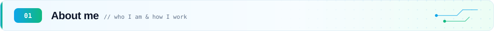

Hi, I'm **Thach** — a fullstack developer who likes taking an idea and turning it into a web app that's fast, reliable and nice to use. I work on both sides: the interface people touch and the systems quietly running behind it.

<table>
<tr>
<td width="50%" valign="top">

<code>01</code> &nbsp;**End to end** 
Responsive UIs, APIs, databases and business workflows.

</td>
<td width="50%" valign="top">

<code>02</code> &nbsp;**AI as a co-pilot** 
AI tools to speed up building and debugging — always reviewed by a human.

</td>
</tr>
<tr>
<td width="50%" valign="top">

<code>03</code> &nbsp;**AI inside products** 
Assistants, retrieval-based features and automation where they actually help.

</td>
<td width="50%" valign="top">

<code>04</code> &nbsp;**Always improving** 
Better architecture, performance and developer experience, one project at a time.

</td>
</tr>
</table>

 

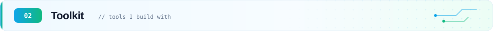

 
  
 
  
 
  
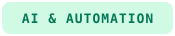 
I bring AI into real products — wiring LLMs into apps, building assistants that answer from your own data with RAG &amp; vector search, automating repetitive workflows with n8n, and running models locally with Ollama when privacy or cost matters. 

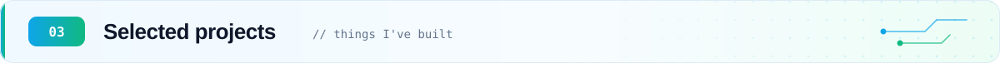

<table>
<tr>
<td width="33%" align="center" valign="top">
<a href="https://github.com/nnthach/artlebake-shop">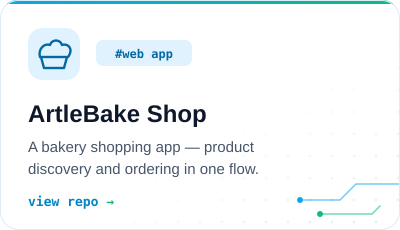</a>
</td>
<td width="33%" align="center" valign="top">
<a href="https://github.com/nnthach/Booking-System-BE">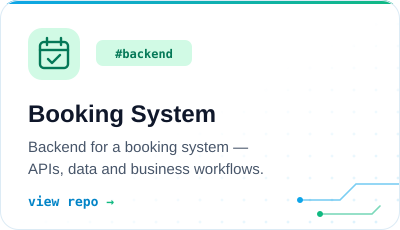</a>
</td>
<td width="33%" align="center" valign="top">
<a href="https://github.com/nnthach/EV-Battery-Swap-Mobile">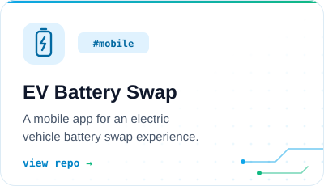</a>
</td>
</tr>
</table>

<a href="https://github.com/nnthach?tab=repositories">→ browse all repositories</a>

 

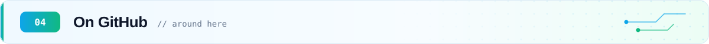

 

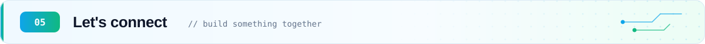

Got an idea, a tricky problem, or something worth building together? I'd love to hear about it.

<!-- Add your LinkedIn, email or portfolio badge here, e.g.

-->

  

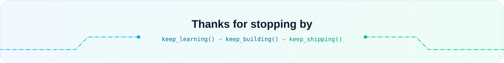

